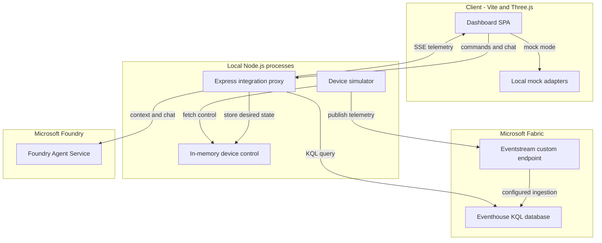
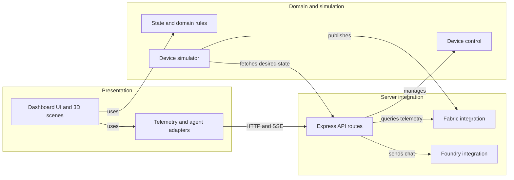

# Architecture Diagram

The application combines a local IoT dashboard and device simulator with optional Microsoft Fabric and Foundry integrations. The external services are not required in mock mode.

## Application Architecture

<!-- mermaid-checked: no \n, no em-dash/en-dash, no {} in labels, subgraphs are id["label"], arrows are -->|"label"|, all subgraphs closed by end, ids unique -->

### Technology Stack Summary

| Layer | Technology | Version | Purpose |
|---|---|---|---|
| UI | JavaScript, Vite, Three.js | Vite 7, Three.js 0.160 | Interactive 3D dashboard and local mocks |
| Server | Node.js, Express | Node.js 24+, Express 5 | Integration API, polling, SSE, local control |
| Ingestion | Azure Event Hubs SDK, Fabric Eventstream | SDK 6 | Publish simulated telemetry |
| Analytics | Fabric Eventhouse and KQL | Managed service | Ingest and query telemetry |
| AI | Microsoft Foundry Agent Service | Managed service | Contextual assistant |
| Identity | Azure Identity | SDK 4 | Authenticate server-side service calls |

### Data Storage & External Services

The Fabric Eventhouse KQL database stores telemetry when configured. Desired device control is held in proxy memory, not persisted in Fabric. The proxy uses Microsoft Foundry for optional chat and Entra credentials for authenticated service calls.

### Key Architectural Decisions

- Telemetry and assistant adapters support independent mock and real integration modes.
- Simulated device control is local HTTP; only telemetry is published to Fabric.
- Server-side credentials remain outside the browser.

## Component Relationships

<!-- mermaid-checked: no \n, no em-dash/en-dash, no {} in labels, subgraphs are id["label"], arrows are -->|"label"|, all subgraphs closed by end, ids unique -->

### Component Inventory

| Component | Layer | Type | Responsibility |
|---|---|---|---|
| Dashboard UI and 3D scenes | Presentation | UI modules | Render scenes and user controls |
| Telemetry and agent adapters | Presentation | Integration adapters | Select mock or server-backed services |
| State and domain rules | Business | Domain modules | Manage state, metrics, and simulation rules |
| Device simulator | Business | Node.js process | Simulate devices and publish telemetry |
| Device control | Business | In-memory store | Maintain desired simulated device state |
| Express API routes | Integration | HTTP and SSE API | Validate requests and distribute telemetry |
| Fabric integration | Integration | Service client | Publish and query telemetry |
| Foundry integration | Integration | Service client | Send contextual chat requests |
